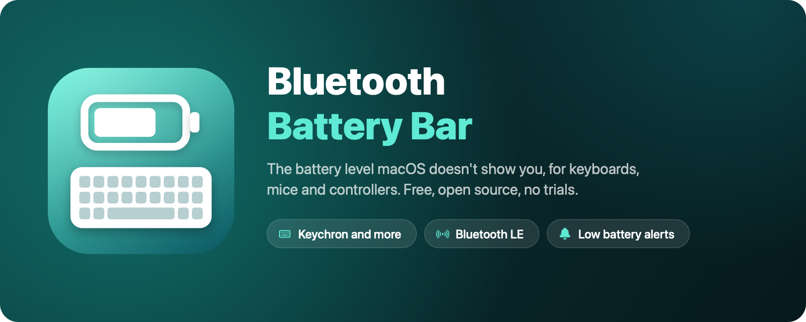
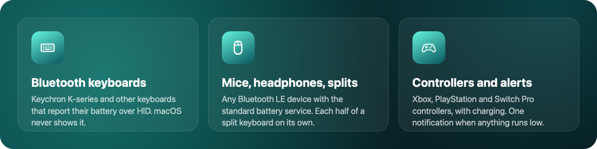
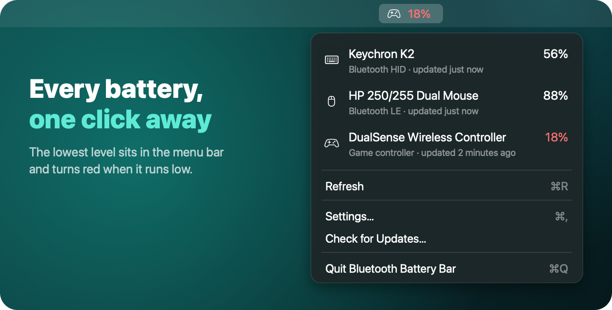
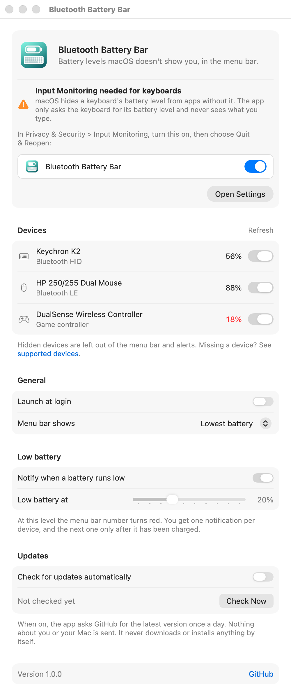
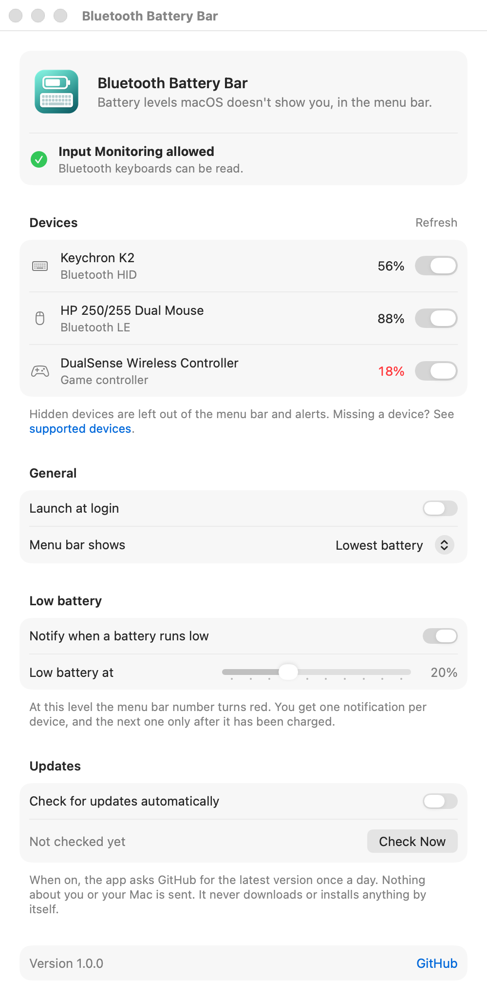

<p align="center">
  
</p>

<p align="center">
  <a href="https://github.com/enso-works/bluetooth-battery-bar/releases/latest"></a>
  
  
  <a href="LICENSE"></a>
</p>

<p align="center">
  <a href="https://github.com/enso-works/bluetooth-battery-bar/releases/latest/download/BluetoothBatteryBar.dmg"><b>Download</b></a> ·
  <a href="#homebrew">Homebrew</a> ·
  <a href="#supported-devices">Supported devices</a> ·
  <a href="docs/vendor-protocols.md">Vendor protocols</a>
</p>

# Bluetooth Battery Bar

**See the battery level of keyboards, mice and controllers that macOS doesn't show.**

macOS shows the battery of Apple's own keyboards, mice and AirPods. Plenty of other devices report their battery level too, like a Keychron keyboard, a Bluetooth mouse or a game controller, but macOS never puts it anywhere you can see. Bluetooth Battery Bar reads it and puts the lowest level in your menu bar, with a notification before anything runs flat.

> [!TIP]
> **Free forever. $0, no trial, no license key, no "pro" version, no ads, no tracking.**
> See [the promise](#free-forever).

<p align="center">
  
</p>

## Contents

- [Features](#features)
- [Supported devices](#supported-devices)
- [Install](#install)
- [First launch](#first-launch)
- [Settings](#settings)
- [Troubleshooting](#troubleshooting)
- [Uninstall](#uninstall)
- [Build from source](#build-from-source)
- [How it works](#how-it-works)
- [Privacy](#privacy)
- [Free forever](#free-forever)
- [FAQ](#faq)
- [Contributing](#contributing)
- [License](#license)

## Features

- **The lowest battery in the menu bar.** The icon shows which kind of device it is. You can pin one device instead, or show only the icon.
- **Red when it runs low**, plus one notification per device. The next one comes only after the device has been charged.
- **Every device in one menu**, with its level, how it was read and when.
- **Split keyboards show each half** when the keyboard reports both.
- **Game controllers show charging** as well as the level.
- **Hide devices** you don't care about, such as a phone.
- **Launch at login**, using the standard macOS login items.
- **Optional update check.** Off by default. It never downloads or installs anything by itself.
- **Universal binary.** Runs natively on Apple Silicon and Intel Macs with macOS 13 Ventura or later. Signed and notarized by Apple.

<p align="center">
  
</p>

## Supported devices

The app reads every device that reports its battery in one of these standard ways. There is no list of models: if a device uses one of these, it shows up.

| How the device reports it | Typical devices | Tested with |
| --- | --- | --- |
| **HID "Battery Strength"** over Bluetooth or USB | Keychron K-series and other keyboards that report it (needs [Input Monitoring](#first-launch)) | Keychron K2 |
| **Bluetooth LE Battery Service** | Mice, headphones, split keyboards (each half), presenters | HP 250/255 Dual Mouse |
| **Apple's GameController framework** | Xbox, DualSense, DualShock 4 and Switch Pro controllers | Not yet, reports welcome |
| **macOS's own value** | Magic Keyboard, Magic Mouse, Magic Trackpad | Shown alongside the others |

### Not supported yet

- **Vendor protocols**, mostly over USB receivers: Logitech Bolt, Unifying and Lightspeed, gaming headsets from SteelSeries, Logitech G, Corsair and HyperX, and Razer devices. They're listed in [docs/vendor-protocols.md](docs/vendor-protocols.md) for a later version.
- **Devices that never report a level.** Many cheap 2.4 GHz mice and keyboards don't send one at all, so there is nothing to read.

### Check your device

Run this in Terminal to print everything the app can read right now:

```sh
"/Applications/Bluetooth Battery Bar.app/Contents/MacOS/BluetoothBatteryBar" --list
```

## Install

### Download

1. **[Download BluetoothBatteryBar.dmg](https://github.com/enso-works/bluetooth-battery-bar/releases/latest/download/BluetoothBatteryBar.dmg)** (always the latest version). A `.zip` is also on the [Releases page](https://github.com/enso-works/bluetooth-battery-bar/releases/latest).
2. Open the DMG and drag **Bluetooth Battery Bar** onto the **Applications** folder.
3. Open it from Applications or Spotlight. It is notarized by Apple, so it opens like any other app.

### Homebrew

```sh
brew install --cask enso-works/tap/bluetooth-battery-bar
```

### Build it yourself

```sh
git clone https://github.com/enso-works/bluetooth-battery-bar.git
cd bluetooth-battery-bar
make install
```

## First launch

The settings window opens together with up to three macOS prompts.

1. **Bluetooth:** click **Allow**. Needed for Bluetooth LE devices such as mice and headphones.
2. **Notifications:** click **Allow** to get the low battery alert.
3. **Input Monitoring:** needed for Bluetooth keyboards. Click **Open Settings** in the app, turn on **Bluetooth Battery Bar** in **Privacy & Security > Input Monitoring**, then choose **Quit & Reopen**.

**Why Input Monitoring?** macOS hides every field of a keyboard from apps without it, the battery level included. The app only asks the keyboard for its battery report. It never listens to key presses. The [code that does this](Sources/BluetoothBatteryBar/HIDBatterySource.swift) is short, so you can check.

<p align="center">
  <picture>
    <source media="(prefers-color-scheme: dark)" srcset="docs/images/permission-dark.png">
    
  </picture>
</p>

## Settings

Open **Settings...** from the menu bar icon, or open the app again from Spotlight.

<p align="center">
  <picture>
    <source media="(prefers-color-scheme: dark)" srcset="docs/images/settings-dark.png">
    
  </picture>
</p>

| Setting | What it does | Default |
| --- | --- | --- |
| Devices | Every device reporting a battery. Switch one off to hide it from the menu, the menu bar and alerts. | All shown |
| Launch at login | Start automatically when you log in | Off |
| Menu bar shows | The lowest battery, one device, or only the icon | Lowest battery |
| Notify when a battery runs low | One notification per device when it reaches the low level | On |
| Low battery at | The level that counts as low, from 5% to 50% | 20% |
| Check for updates automatically | Ask GitHub once a day whether a new version is out | Off |

## Troubleshooting

<details>
<summary><b>My keyboard or mouse doesn't show up</b></summary>

- **It may be asleep.** Many keyboards, Keychron included, disconnect after a few minutes without use. Press a key; the device shows up again within a few seconds.
- **Keyboards need Input Monitoring.** Open Settings and check that it shows as allowed.
- **Bluetooth LE devices need Bluetooth access.** Check **System Settings > Privacy & Security > Bluetooth**.
- **The device may not report a battery level**, or only through a vendor protocol. Run the [`--list` command](#check-your-device) and compare with [Supported devices](#supported-devices).

</details>

<details>
<summary><b>Input Monitoring is on, but keyboards still don't show up</b></summary>

macOS applies the permission after the app restarts. Choose **Quit** from the menu bar icon and open the app again. If that doesn't help, select Bluetooth Battery Bar in **System Settings > Privacy & Security > Input Monitoring**, remove it with **–**, then open the app and allow it again.

</details>

<details>
<summary><b>The level jumps in steps or doesn't change for a while</b></summary>

The number comes from the device itself. Some devices only report it in steps of 10% or more, or update it every few minutes. The app reads it every 5 minutes, when a device connects and when your Mac wakes up. **Refresh** in the menu reads it right away.

</details>

## Uninstall

1. Click the menu bar icon and choose **Quit Bluetooth Battery Bar**.
2. Delete **Bluetooth Battery Bar.app** from Applications, or run `brew uninstall --cask bluetooth-battery-bar`.
3. Optional cleanup:
   - Remove it from **System Settings > Privacy & Security > Input Monitoring** and **Bluetooth**.
   - Delete its settings:
     ```sh
     defaults delete works.enso.BluetoothBatteryBar
     ```

## Build from source

Requirements: macOS 13 or later and Xcode (the universal build needs it, not just the Command Line Tools). No Xcode project and no dependencies.

```sh
make app          # universal .app in build/
make install      # build, copy to /Applications and start it
make list         # build and print what the app can read right now
make dmg          # release DMG and zip in dist/
make art          # re-render the icon and README artwork
make screenshots  # re-render the settings window screenshots
make clean
```

The build signs with your first **Apple Development** certificate, so the Input Monitoring permission survives rebuilds. Without one it signs ad-hoc, and macOS asks again after every build. To choose a certificate:

```sh
SIGN_IDENTITY="Apple Development: Your Name (TEAMID)" make install
```

To list your certificates, run `security find-identity -v -p codesigning`.

### Project layout

```
Sources/BluetoothBatteryBar/
  App.swift                    Entry point, app delegate and the --list command
  StatusItemController.swift   Menu bar item and menu
  BatteryMonitor.swift         Merges the sources and refreshes them
  DeviceBattery.swift          One reading: device, level, charging, how it was read
  SystemBatterySource.swift    macOS's own value for Apple devices
  HIDBatterySource.swift       HID "Battery Strength" from any HID device
  BLEBatterySource.swift       Bluetooth LE Battery Service
  ControllerBatterySource.swift  Game controllers
  LowBatteryAlerts.swift       Low battery notifications
  AppSettings.swift            Preferences stored in UserDefaults
  SettingsView.swift           SwiftUI settings window
  Permissions.swift            Input Monitoring, Bluetooth and launch at login helpers
  UpdateChecker.swift          Opt-in check for a newer GitHub release
Resources/                     Info.plist and the 1024px icon
scripts/                       App bundling, DMG packaging, artwork and screenshots
docs/vendor-protocols.md       Vendor protocols planned for later versions
```

## How it works

1. **Apple devices:** macOS keeps their level in the I/O Registry (`BatteryPercent`), and the app reads it from there.
2. **HID devices:** the app lists every HID device and picks the ones whose descriptor declares **Battery Strength** (usage page `0x06`, usage `0x20`). It opens them without exclusive access and requests that one value, the way the HID standard defines for reading a value on demand. Devices like the Keychron K2 only send it when asked. The device keeps working normally, and key presses never reach the app.
3. **Bluetooth LE devices:** macOS already holds the connection. The app joins it through CoreBluetooth, reads every **Battery Level** characteristic (`0x2A19`) of the **Battery Service** (`0x180F`), and subscribes to changes. A characteristic's description, if it has one, names the part, such as the other half of a split keyboard.
4. **Game controllers:** Apple's GameController framework reports the level and whether the controller is charging.
5. Readings are merged by device name, preferring macOS's own value, then the controller framework, then HID, then Bluetooth LE. They refresh every 5 minutes, when a device connects and when the Mac wakes.

Only public macOS APIs are used, so there are no private APIs to break on OS updates.

## Privacy

- No analytics or telemetry.
- No network access, with one optional exception: if you turn on **Check for updates automatically** (off by default) or click **Check Now**, the app sends one anonymous HTTPS request to the public GitHub API for the latest release version. Nothing about you, your Mac or your devices is sent.
- Input Monitoring is used only to request the battery level from keyboards. Key presses never reach the app.
- Nothing is stored except your settings. The app writes one line per HID battery read (device name and level) to the macOS system log, which stays on your Mac and helps track down devices that drop their connection.

## Free forever

This project will always be **free of charge and open source**:

- **$0.** No trial period, no license key, no paid tier, no "unlock" purchase, no subscription.
- **No ads, no telemetry, no account.** The app doesn't connect to the internet unless you turn on the optional update check.
- **Every feature is included.** Nothing is held back for a paid version, because there is no paid version.
- **MIT licensed.** Even if this repository disappeared or the maintainer changed their mind, anyone can fork the code and keep it free. The license makes that permanent.

If a website asks you to pay for "Bluetooth Battery Bar", it isn't this project. The only official downloads are on the [GitHub Releases page](https://github.com/enso-works/bluetooth-battery-bar/releases) and the [Homebrew tap](#homebrew).

## FAQ

<details>
<summary><b>How do I check my Keychron keyboard's battery on a Mac?</b></summary>

Install this app and allow Input Monitoring. The K-series reports its level, but macOS doesn't show it anywhere. Without an app, the keyboard's indicator light is the only hint: it turns red when the battery is low.

</details>

<details>
<summary><b>Why doesn't macOS show it?</b></summary>

macOS only displays battery levels for devices it has special support for, mostly Apple's own and some headphones. Many other devices report their level in a standard field that macOS reads past. This app reads that field.

</details>

<details>
<summary><b>Is it safe? Why does it need Input Monitoring?</b></summary>

macOS hides all of a keyboard's data from apps without Input Monitoring, including the battery level. The app opens the keyboard only to request that one value and never listens to key presses. It doesn't connect to the internet unless you turn on the optional update check. The code is short and public, so you can check exactly what it does, or [build it yourself](#build-from-source).

</details>

<details>
<summary><b>Does it work with Logitech devices?</b></summary>

In Bluetooth mode, a Logitech device shows up if it offers the standard Bluetooth LE battery service. Through a Bolt, Unifying or Lightspeed receiver it doesn't yet, because those use Logitech's own protocol. It's first on the [vendor protocol list](docs/vendor-protocols.md).

</details>

<details>
<summary><b>Is this a free alternative to Magic Battery or iStat Menus?</b></summary>

For seeing peripheral battery levels in the menu bar, yes. Those are good apps, and iStat Menus does far more than batteries. If all you need is the battery level of a keyboard, mouse or controller that macOS doesn't show, this app does that for free.

</details>

## Contributing

Issues and pull requests are welcome. The most useful things right now:

- **Device reports.** If a device works, or doesn't, open an issue with its name and the output of the [`--list` command](#check-your-device).
- **Vendor protocols** from [docs/vendor-protocols.md](docs/vendor-protocols.md), starting with Logitech HID++.
- A Homebrew cask in the main Homebrew repository, and localization.

For larger changes, please open an issue first so we can agree on the approach.

## License

[MIT](LICENSE). Free to use, modify and share, forever.
